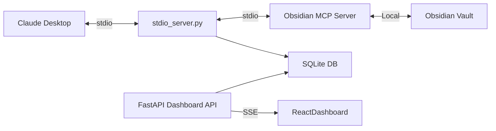

# MCP Shield

An AI Security Proxy for Obsidian MCP Server. Built for the AWS Hackathon MVP.

## Architecture



## Folder Structure

- `/proxy`: FastAPI backend that intercepts MCP requests.
- `/frontend`: React dashboard for monitoring and policies.
- `/policies`: JSON files storing the security policies.
- `/database`: SQLite database for audit logs.

## Setup Instructions

### Backend (FastAPI Proxy)

1. Create a virtual environment and install dependencies:
   ```bash
   pip install -r requirements.txt
   ```
2. Start the proxy:
   ```bash
   python -m proxy.main
   ```

### Frontend (React Dashboard)

1. Install dependencies:
   ```bash
   cd frontend
   npm install
   ```
2. Start the dev server:
   ```bash
   npm run dev
   ```

## Connecting to Claude Desktop

Configure Claude Desktop (`claude_desktop_config.json`) to point to the MCP Shield stdio server instead of the direct Obsidian MCP Server.

```json
{
  "mcpServers": {
    "obsidian-shield": {
      "command": "python",
      "args": ["-m", "proxy.stdio_server"]
    }
  }
}
```
